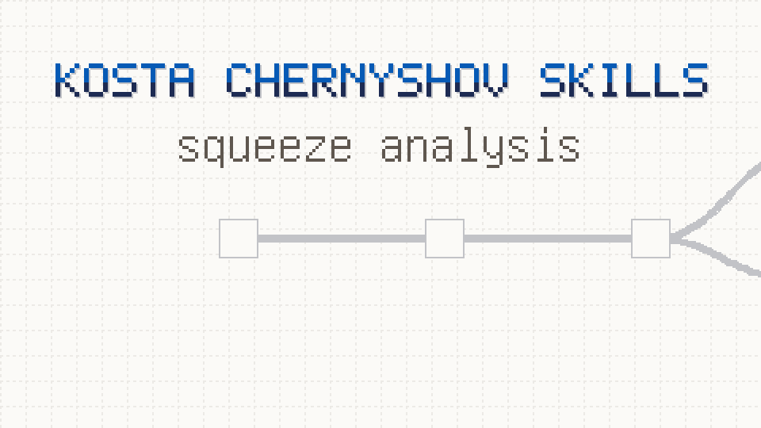

# Bio decision skills

Skills for Claude Code (and other agents that read SKILL.md) for one path: from the question of a client to a decision that the client can trust.



This repository does not teach methods. Method catalogs exist (see `UPSTREAM.md`). This repository covers the layers around the method. Each skill is one role with one clear action:

- understand the task before the work: who gets the benefit, how, and why it can work (`grill-me`, `grill-with-plan`, `grilling`),
- fix the threshold and the controls before the data (`planner`),
- start the analysis only from an accepted plan, in a clean context (`analyze`),
- check each result before you state it (`checker`),
- keep the project memory and order without manual notes (`setup-project`, `curator`),
- write the report in a fresh context and check it from the files only (`editor`, `supervisor`, `reviewer`),
- give the person a short deck and a signed release (`designer`, `publisher`).

The person is responsible for the result. The person acts at three points: the answers in grilling, the approval of the plan, and the signature of the release. Each decision line shows who made it: `(person)` or `(agent)`.

Scope of version 1: processed tabular data (expression tables, clinical tables, mutation calls, survival). No raw data.

## Start

Type `/ask-kosta` in a project. It tells you the next skill. As a plugin, the commands have the plugin prefix: `/kostachernyshov-skills:ask-kosta`.

## Skills

| Skill | Who starts it | What it does |
|---|---|---|
| `ask-kosta` | person | Map of the flow. Tells the next skill. |
| `setup-project` | person | Makes the project layout and two service files. |
| `grill-me` | person | Starts `grilling`. |
| `grill-with-plan` | person | `grilling`, then `planner`. Ends when the person approves the plan. Each new run starts here. |
| `grilling` | agent | Interview in rounds until the solution model of the project and the task of the run are clear. Marks each decision `(person)` or `(agent)`. Checks the project rules. |
| `planner` | agent | Writes the plan: threshold, positive, negative, and robustness controls. The person approves it. If more than half of the decisions came from the agent, the person must say "start anyway". Does not run the analysis. |
| `analyze` | person | Runs the accepted plan, best in a new session: environment, code, figures, checks, then `editor`. Stops without an accepted plan. |
| `checker` | agent | Checks and controls before each result. Doubts become `todo`. "New" only after a literature search. Stops after 3 failed repairs. |
| `curator` | hook + agent | A script builds the State in `CLAUDE.md` from `run.yaml` after each answer and lists files out of place. Keeps the project rules. |
| `editor` | agent | A fresh subagent writes the one-page report from the files. Then calls `supervisor` and `reviewer`. |
| `supervisor` | agent | A fresh subagent answers 7 yes/no questions from the files only. One "no" is a veto. It always runs. It checks the reason of an override. |
| `designer` | person | 4 to 6 slides from the report for the decision meeting. Calls `reviewer`. |
| `reviewer` | agent | Two review rounds of the deck or the report with the eyes of the reader. |
| `publisher` | person | Freezes a release. Only with a supervisor pass or a valid override, and only after the person signs. |
| `animate` | person | Experimental (`skills/in-progress/`). A pixel-art video of 20 to 45 s from the accepted report: question, design, result, limit. Numbers come only from the result files. Checks the colors for color vision deficiency. |

"Person" skills have `disable-model-invocation: true`. Type `/name` to start them. "Agent" skills start by themselves when the situation fits. A person skill can call an agent skill, never another person skill.

The `curator` hook (`hooks/hooks.json`, event `Stop`) works in Claude Code when you install the plugin. With a manual install or in Codex, ask the agent to run the curator script.

## Project layout

```
CLAUDE.md   # agent rules + State (built by the curator script)
LOG.md      # decisions of the person and releases
data/       # input, read only
runs/       # iterations, each with run.yaml (plan, controls, checks, todo, verdict)
releases/   # what the client saw, never changed
scratch/    # temporary
```

## Install

As a Claude Code plugin (after the repository is public):

```
claude plugin marketplace add kostachernyshov/skills
claude plugin install kostachernyshov-skills@kostachernyshov
```

To update: `claude plugin marketplace update kostachernyshov`, then `claude plugin update kostachernyshov-skills@kostachernyshov`.

Codex (not tested yet) uses the same marketplace and reads `agents/openai.yaml` in each skill folder:

```
codex plugin marketplace add kostachernyshov/skills
codex plugin add kostachernyshov-skills@kostachernyshov
```

Or copy the skills by hand (the curator hook does not come with this route):

Claude Code finds a skill only one level below the skills folder. Copy each skill folder, not the bucket folder:

```
for d in skills/ask-kosta skills/*/*/; do cp -r "$d" ~/.claude/skills/; done
```

Do not copy `skills/in-progress/` or `skills/deprecated/`.
