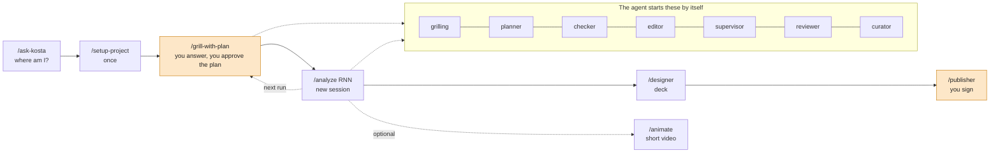

# Bio decision skills

Skills for Claude Code and Codex that take a bioinformatics project from the question of a client to a decision that the client can trust.

You have a question ("Does this gene score predict survival?", "Can we skip this test in smokers?") and processed tables: expression, clinical data, mutation calls, survival. The skills make the agent ask you the right questions first, fix a plan with a success threshold and controls before it looks at the outcome, check each result, and write a one-page report that a fresh agent checks against the files. You approve the plan and sign the release. The agent does the routine work.

It is for heads of bioinformatics, bioinformaticians, and the wet-lab and clinical researchers who work with them. It does not teach methods and does not process raw data (see [UPSTREAM.md](UPSTREAM.md)).

## How it works



You act at three points (orange): the answers in grilling, the approval of the plan, and the signature of the release. Each decision line in the project shows who made it: `(person)` or `(agent)`.

A large task is split into several runs. Each run has its own question, plan, and report. A later run can use the results of earlier runs.

## Install

Claude Code, as a plugin (this also installs the curator hook):

```
claude plugin marketplace add kostachernyshov/skills
claude plugin install kostachernyshov-skills@kostachernyshov
```

Start a new Claude Code session in your project folder and type `/kostachernyshov-skills:ask-kosta`. The plugin adds the prefix `kostachernyshov-skills:` to each command.

Codex (not tested yet) reads the same marketplace and `agents/openai.yaml` in each skill folder:

```
codex plugin marketplace add kostachernyshov/skills
codex plugin add kostachernyshov-skills@kostachernyshov
```

Manual copy (no plugin prefix, no curator hook; ask the agent to run the curator when a session ends):

```
git clone https://github.com/kostachernyshov/skills
cd skills
mkdir -p ~/.claude/skills
for d in skills/ask-kosta skills/{analysis,core,decision,project}/*/; do cp -r "$d" ~/.claude/skills/; done
```

Claude Code finds a skill only one level below the skills folder, so the loop copies each skill folder, not the bucket folder. It does not copy `skills/in-progress/` or `skills/deprecated/`.

## Update

```
claude plugin marketplace update kostachernyshov
claude plugin update kostachernyshov-skills@kostachernyshov
```

Restart the session after the update. You get an update only when the version in `.claude-plugin/plugin.json` changes. Read what changed in [CHANGELOG.md](CHANGELOG.md): each version starts with "What changes for you". With a manual copy, pull the repository and copy the folders again.

## Example: a T-cell score in melanoma

Public data: TCGA SKCM from UCSC Xena (test scenario [`tests/scenarios/s5-skcm-immune`](tests/scenarios/s5-skcm-immune/persona.md)). A biotech wants to print "a high cytotoxic T-cell score predicts longer survival in melanoma" in a brochure.

1. Put the tables in an empty folder. Type `/ask-kosta`. It says: start with `/setup-project`.
2. `/setup-project` makes `CLAUDE.md`, `LOG.md`, `data/`, `runs/`, and `releases/`, and asks your name and role.
3. `/grill-with-plan` asks in short rounds, each with a recommended option:
   - Who gets the benefit, and which decision changes? (The brochure claim: strong, weak, or none.)
   - Which error costs more: a false claim or a too weak claim?
   - Survival from which time? (Most samples are metastases collected years after diagnosis.)
   - What number makes the answer "yes"?
   Then it shows the plan in 5 to 8 lines: samples, method, threshold, and three controls (a known effect, shuffled labels, nearby thresholds and subgroups). You type "yes".
4. `/clear`, then `/analyze R01`. The agent runs the plan, checks the data and the controls, draws the figures, and writes `runs/R01-<slug>/out/report.md` and `report.pdf`. A fresh supervisor answers 7 yes/no questions from the files only.
5. `/designer` makes a deck of 4 to 6 slides. `/publisher` shows what goes out and asks you to sign. The release goes to `releases/v1-<date>/` and gets a git tag.

## Animation (experimental)


After `/analyze`, type `/animate` to get a 20 to 45 s pixel-art video of the run: the question, the design, the result, and the limit. Each number on screen comes from a result file. See [`skills/in-progress/animate`](skills/in-progress/animate/SKILL.md).

## More

- [All skills and the project layout](docs/skills.md)
- [Scope: what gets into this repository](SCOPE.md)
- [Glossary](GLOSSARY.md)
- [Tests on public data](tests/README.md)
- Issues and ideas: https://github.com/kostachernyshov/skills/issues

License: MIT.
